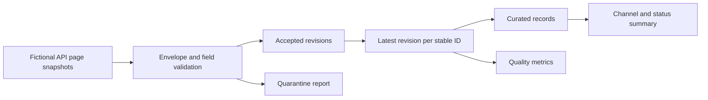

# Enterprise Data Pipeline & Analytics

An independently authored, synthetic engineering demonstration of transforming paginated operational records into traceable, quality-controlled analytical data.

**Scope:** This is a fictional system and a small working example, not a copy, extraction, reimplementation, or publication of any employer or client system. It makes no claims about live production throughput, scale, commercial outcomes, or private project results.

## Engineering problem

An operational API often yields multiple pages of partially inconsistent records, including revised items, unsupported values, and missing fields. An analytics pipeline needs a stable record identity, reproducible revision selection, explicit exception handling, and outputs whose counts can be reconciled.

## Architecture



## Demonstrated capabilities

- **Page validation:** validates synthetic pagination envelopes and rejects duplicate page numbers.
- **Schema contracts:** requires canonical ID, update timestamp, channel, status, and category.
- **Identifier governance:** selects a single current record for each stable ID, using update time and a deterministic tie-breaker.
- **Exception isolation:** records invalid entries in a quarantine output instead of silently dropping them.
- **Data quality and reconciliation:** reports accepted distinct IDs, rejected rows, and page counts; summary totals derive from curated records.
- **Reproducibility:** outputs are sorted and written as readable JSON, with no network calls or external dependencies.
- **Testing:** checks revision selection, invariance to page order, invalid inputs, duplicate pages, reconciled totals and file outputs.

## Run locally

Python 3.11 or newer; standard library only.

```bash
python3 -m unittest discover -s tests -v
python3 -m pipeline.etl --input data/fictional_pages.json --output output
```

Expected quality summary for the fictional sample: **2 pages, 4 distinct valid IDs, 1 rejected record**. `output/` is intentionally excluded from source control.

## Data contracts and trade-offs

See [design notes](docs/design.md) for input/output contracts, assumptions, limitations, and the distinction between this illustration and production-grade API ingestion.

## Rights and provenance

All source code, documents and example records in this repository were independently created for the public case study. All data are fictional. No employer or client code, records, secrets, operational logs, internal schema mappings, proprietary designs or private version history are included.

**Copyright © 2026 David Brown. All rights reserved.** No open-source licence is granted. See [NOTICE.md](NOTICE.md).
