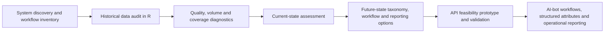

# Enterprise Data Pipeline & Analytics

**Operational systems assessment, R-based exploratory analysis, future-state design and data engineering.**

This portfolio case study describes an analytical consulting approach: establish how an operational system behaves, diagnose the quality and usefulness of its data, assess workflow and reporting constraints, and translate evidence into a feasible target-state design. Two independent, synthetic implementations illustrate complementary capabilities: an **R current-state analytical audit** and a **Python data-quality pipeline**. Neither uses original client data or implementation code.

## The problem

Operational customer-interaction platforms can accumulate workflows, tags and configuration choices without a consistent reporting model. A tag might describe a source channel, business unit, customer intent or outcome; when those uses are mixed, volume statistics alone cannot reliably explain system performance or support future automation decisions.

## End-to-end engagement



The private source archive documents a 2025 consulting engagement that examined **26 workflows** and **more than 25,000 conversations** across January–May 2025. These are historical project-scope figures, not metrics generated by this public demonstration. Original records, source reports and client-specific designs are not included.

## Analytical methods and decisions

- **Data preparation in R:** date normalisation, missing-tag treatment, multi-tag expansion, stable conversation-level counting and duplicate tag-pair removal.
- **Descriptive analysis:** monthly volumes and tagging coverage; brand/channel segmentation where distinguishable; trends in tag usage and relative concentration.
- **Relational diagnostics:** co-occurrence of tags within conversations to reveal overlapping classifications and candidate taxonomy conflicts.
- **Workflow assessment:** map the purposes and coverage of existing automations against operational needs; distinguish routing, simple tagging, closure and feedback collection.
- **Reporting feasibility:** assess whether available labels and structured attributes can support the measures stakeholders need.
- **Target-state design:** separate source, business dimension, intent, outcome and workflow concepts; evaluate standardised application and an external reporting layer where native tooling is insufficient.
- **Implementation:** use the findings to refine custom data attributes that capture progression through newly created AI-bot chat workflows and support operational reporting.

Read the [analytical consulting case study](docs/analytical-consulting-case-study.md) for the evidence-to-recommendation chain, the [reproducible synthetic R audit](docs/r-analytical-demo.md) for worked analytics, and the [technical design notes](docs/design.md) for the independent Python ETL example.

## Reproducible R analytical demonstration

The separately authored [synthetic R analysis](docs/r-analytical-demo.md) illustrates conversation-level quality profiling, monthly coverage and volume trends, deduplicated tag co-occurrence, and rule-guided reporting recommendations. It generates CSV summaries and two ggplot2 charts from **20 fictional conversations**. No original client scripts, records, configurations or report outputs are present.

```bash
Rscript tests/test_current_state.R
Rscript analysis/current_state.R data/fictional_conversations.csv output/r-analysis
```

**Requirements:** R and `ggplot2` (for the charts). The R illustration and the Python ETL example are independent synthetic examples, not a reproduction of the private operational environment.

## What the working code demonstrates

**R analytics (`analysis/current_state.R`):** A separate fictional 20-conversation dataset is analysed for monthly volume, tagging coverage, tag co-occurrence and data-quality issues. It produces CSV summaries, simple recommendation prompts and ggplot2 figures. The R example does **not** reproduce historical client measurements, workflows or reports.

**Python engineering (`pipeline/etl.py`):** A narrow fictional API-page example validates paginated snapshots, applies stable identity and revision rules, quarantines invalid rows and produces reproducible quality and summary outputs.

```bash
python3 -m unittest discover -s tests -v
python3 -m pipeline.etl --input data/fictional_pages.json --output output
Rscript tests/test_current_state.R
Rscript analysis/current_state.R data/fictional_conversations.csv output/r-analysis
```

The Python fixture produces **2 pages, 4 valid distinct IDs and 1 rejected record**. The separate R fixture includes **20 fictional conversations, 15 tagged and 5 untagged**, spanning three months. These figures are synthetic and unrelated to the consulting engagement. The R chart-generation command requires `ggplot2`; its analytical regression tests use base R. Both implementations have passed their GitHub Actions validation.

## Consulting outcome and limits

The engagement combined an R-based current-state assessment with future-state workflow design and implementation. The delivered result was a carefully structured custom-data-attribute model that captured progression through newly created AI-bot chat workflows, together with supporting operational reports. The work connected analytical findings to practical workflow configuration, operational visibility and stakeholder handover.

## Publication boundary

The public narrative is independently authored from an owner-controlled private evidence archive. No original client scripts, detailed process mappings, raw conversations, source presentations, API credentials, operational logs or private repository history are included. The demonstration data are fictional. **Copyright © 2026 David Brown. All rights reserved.** See [NOTICE.md](NOTICE.md).
