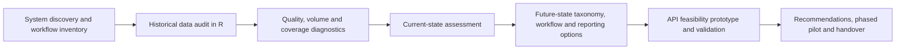

# Enterprise Data Pipeline & Analytics

**Operational systems assessment, R-based exploratory analysis, future-state design and data engineering.**

This portfolio case study describes an analytical consulting approach: establish how an operational system behaves, diagnose the quality and usefulness of its data, assess workflow and reporting constraints, and translate evidence into a feasible target-state design. A separate, independently authored Python demonstration illustrates one supporting technical control: producing quality-assured analytical records from fictional paginated input.

## The problem

Operational customer-interaction platforms can accumulate workflows, tags and configuration choices without a consistent reporting model. A tag might describe a source channel, business unit, customer intent or outcome; when those uses are mixed, volume statistics alone cannot reliably explain system performance or support future automation decisions.

## End-to-end engagement



The private source archive documents a 2025 consulting engagement that examined **26 workflows** and **more than 25,000 conversations** across January–May 2025. These are historical project-scope figures, not metrics generated by this public demonstration. Original records, source reports and client-specific designs are not included.

## Analytical methods and decisions

- **Data preparation in R:** date normalisation, missing-tag treatment, multi-tag expansion, stable conversation-level counting and duplicate tag-pair removal.
- **Descriptive analysis:** monthly volumes and tagging coverage; brand/channel segmentation where distinguishable; trends in tag usage and relative concentration.
- **Relational diagnostics:** co-occurrence of tags within conversations to reveal overlapping classifications and candidate taxonomy conflicts.
- **Workflow assessment:** map the purposes and coverage of existing automations against operational needs; distinguish routing, simple tagging, closure and feedback collection.
- **Reporting feasibility:** assess whether available labels and structured attributes can support the measures stakeholders need.
- **Target-state design:** separate source, business dimension, intent, outcome and workflow concepts; evaluate standardised application and an external reporting layer where native tooling is insufficient.
- **Controlled prototyping:** test metadata-enrichment feasibility through API operations and examine the practical limits of downstream reporting.

Read the [analytical consulting case study](docs/analytical-consulting-case-study.md) for the evidence-to-recommendation chain and [technical design notes](docs/design.md) for the independent synthetic ETL example.

## What the working code demonstrates

The `pipeline/` example is **a narrow, fictional illustration**, not the archived consulting implementation. It validates paginated snapshots, applies stable identity and revision rules, quarantines invalid rows and produces reproducible quality and summary outputs.

```bash
python3 -m unittest discover -s tests -v
python3 -m pipeline.etl --input data/fictional_pages.json --output output
```

The synthetic fixture produces **2 pages, 4 valid distinct IDs and 1 rejected record**. These figures are not client results. The executable example does **not** implement the R audit or recreate client dashboards.

## Consulting outcome and limits

The consulting contribution was to turn existing operational data and configuration into a structured assessment, test a plausible reporting-data design, and communicate future-state options. Archived analysis identified inconsistent tagging and limitations in the native reporting experience. API-populated attributes were tested for feasibility, but the archive does **not** establish that the proposed reporting capability was fully delivered or that workflow changes produced quantified business improvements.

## Publication boundary

The public narrative is independently authored from an owner-controlled private evidence archive. No original client scripts, detailed process mappings, raw conversations, source presentations, API credentials, operational logs or private repository history are included. The demonstration data are fictional. **Copyright © 2026 David Brown. All rights reserved.** See [NOTICE.md](NOTICE.md).
